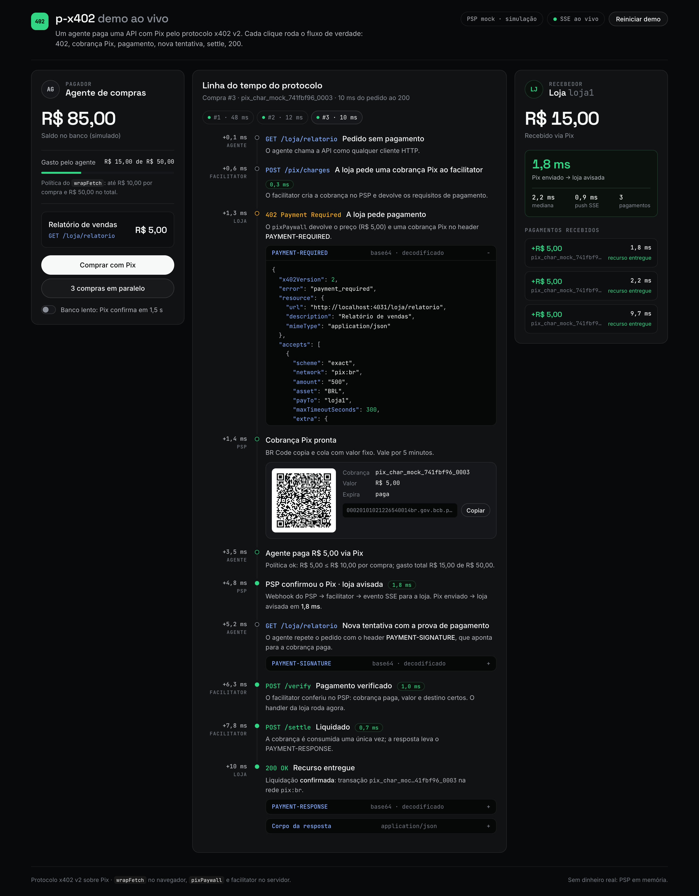

# demo-web: o p-x402 ao vivo, num link público

Demo do protocolo para quem abre o link: um **agente** compra `GET /relatorio` por R$ 5,00 e paga com Pix, e a **loja** vê o pagamento chegar na hora. Sem login e sem instalar nada. Cada compra roda o fluxo x402 v2 de verdade: 402 → cobrança Pix → pagamento → nova tentativa com `PAYMENT-SIGNATURE` → verify → handler → settle → 200 com `PAYMENT-RESPONSE`.



## Rodar localmente

```bash
bun run demo:web
```

Abra http://localhost:4030. Sem `ABACATEPAY_API_KEY`, o PSP é o mock em memória e nada precisa de segredo.

## Como funciona

Um processo Bun só (`src/index.ts`) com o agente, a loja, o facilitator e a página:

- **O agente roda no servidor.** Ele usa o `wrapFetch` de `@p-x402/client`, com política de R$ 10,00 por compra e R$ 50,00 no total. A loja é o `pixPaywall` de `@p-x402/server` e o facilitator é o de `apps/facilitator`, todos chamados dentro do processo. A chave do PSP e a rota `simulate-payment` nunca ficam expostas.
- **A página só desenha.** Ela inicia compras e recebe os eventos da própria sessão por Server-Sent Events, sem polling. Os eventos trazem os headers decodificados de cada passo, o id da cobrança, o BR Code, que vira QR, e o resultado do settle.
- **Sessões sem login.** O navegador gera um id aleatório e o guarda no `localStorage`. Cobranças, eventos, saldos e o gasto do agente pertencem a essa sessão, e cada visitante só vê a própria.
- **Dois modos.**
  - "Um clique" roda a compra inteira, com a opção de "banco lento" para mostrar o `settlement_pending`.
  - "Passo a passo" para o agente antes de pagar e antes de tentar de novo, esperando o clique do visitante.

  Uma compra parada termina quando a cobrança vence (300 s) ou quando a página fica 15 s sem conexão. A vaga dela é liberada e a página mostra "Sessão expirada, comece de novo".
- **Latência.** "Pix enviado → loja avisada" soma duas medidas:
  - o tempo no servidor, do envio do Pix até o facilitator gravar `PAID`;
  - a entrega do evento SSE ao navegador. O relógio do navegador é alinhado com o do servidor pelo `/health`.
- **O pagamento é simulado nos dois modos.**
  - No mock, o PSP em memória marca a cobrança como paga.
  - No AbacatePay, a demo usa o `simulate-payment` do modo de teste.

  Os saldos são fictícios e só mudam quando o PSP confirma a cobrança. A página mostra qual modo está ativo.
- **Dados do pagador.** O webhook do PSP traz nome e CPF do pagador. O parser descarta esses campos e nada disso é guardado ou exibido; um teste garante isso.

### Rotas públicas

| Rota | O quê |
|---|---|
| `GET /` | a página |
| `GET /health` | `{ ok, provider, store, time }`, para o health check e o relógio da página |
| `GET /api/estado` | estado da sessão (header `x-px402-sessao` ou `?sessao=`) |
| `GET /api/eventos?sessao=` | SSE com os eventos da sessão |
| `POST /api/compras` | compra de um clique; corpo `{ "lento": true }` é opcional |
| `POST /api/passos` | modo passo a passo; corpo `{ "acao": "pedir" \| "pagar" \| "tentar" }` |
| `POST /api/sessao/reiniciar` | zera a sessão do visitante |
| `POST /api/admin/reset` | zera todas as sessões; exige `Authorization: Bearer $DEMO_ADMIN_SECRET` (sem o segredo, responde 404) |
| `POST /facilitator/webhooks/pix` | webhook do PSP |
| `GET /facilitator/supported` | capacidades do facilitator |

O resto do facilitator (inclusive `/dev/charges/:id/simulate-payment`) e a loja não têm rota pública.

### Limites contra abuso

Não há login. No lugar dele:

- **Compras por IP:** `DEMO_RUNS_PER_IP_PER_HOUR`, padrão 30 por hora.
- **Compras simultâneas por sessão:** no máximo 3.
- **Cobranças por IP:** o limite do `pixPaywall`, `DEMO_CHARGES_PER_IP_PER_MINUTE`, padrão 20 por minuto.
- **Cobranças da loja:** o limite do facilitator, compartilhado por todos, `DEMO_MERCHANT_CHARGES_PER_MINUTE`, padrão 60 por minuto.
- **Gasto do agente:** R$ 50,00 por sessão.
- **Reinício diário:** às 04:00 de Brasília (`DEMO_RESET_UTC_HOUR=7`), mais o reset manual por segredo.

O reset apaga sessões, saldos e limites. Os registros de cobrança continuam no SQLite, porque o facilitator precisa deles para reenvios e para expirar cobranças.

## Variáveis de ambiente

| Variável | Padrão | Para quê |
|---|---|---|
| `DEMO_WEB_PORT` | `4030` | porta HTTP (`8080` no `fly.toml`) |
| `NODE_ENV` | | `development` liga o hot reload da página, só para mexer na interface |
| `PX402_PROVIDER` | automático | `abacatepay` ou `mock`. Sem a variável, usa o AbacatePay se `ABACATEPAY_API_KEY` existir e o mock caso contrário |
| `ABACATEPAY_API_KEY` | | **chave do modo de teste (dev mode)** do AbacatePay. Segredo |
| `ABACATEPAY_WEBHOOK_SECRET` | | segredo do webhook, com pelo menos 32 caracteres. Sem ele, a rota do webhook fica desligada. Segredo |
| `PX402_DB_PATH` | memória | arquivo SQLite das cobranças, por exemplo `/data/p-x402.sqlite` num volume |
| `PX402_MERCHANT_TOKEN` | aleatório | token interno entre a loja e o facilitator. Segredo, opcional |
| `DEMO_ALLOWED_ORIGINS` | nenhuma | origens liberadas no CORS, separadas por vírgula. Só é preciso se a página for servida de outra origem |
| `DEMO_ADMIN_SECRET` | | liga o `POST /api/admin/reset`; pelo menos 32 caracteres. Segredo |
| `DEMO_CLIENT_IP_HEADER` | IP do socket | header com o IP real do visitante, posto pelo proxy (`fly-client-ip` na Fly.io) |
| `DEMO_RUNS_PER_IP_PER_HOUR` | `30` | compras por IP por hora |
| `DEMO_CHARGES_PER_IP_PER_MINUTE` | `20` | cobranças por IP por minuto (`pixPaywall`) |
| `DEMO_MERCHANT_CHARGES_PER_MINUTE` | `60` | cobranças por minuto da loja inteira (facilitator) |
| `DEMO_STEP_TIMEOUT_SECONDS` | até a cobrança vencer | tempo máximo de uma compra passo a passo parada, de 1 a 300 |
| `DEMO_RESET_UTC_HOUR` | `7` | hora UTC do reinício diário (`7` = 04:00 em Brasília); `off` desliga |

Um valor inválido derruba a subida com o nome da variável na mensagem.

Para trocar de modo durante o congelamento do código, sem mudar código:

- `fly secrets set PX402_PROVIDER=mock` passa para o mock;
- `fly secrets unset PX402_PROVIDER` volta para o AbacatePay.

## Pôr no ar (passos do time)

Esta seção não foi executada: ninguém fez deploy, criou conta, registrou domínio ou cadastrou webhook. O desenho recomendado é um serviço só em `demo.p-x402.com`, servindo a página e a API na mesma origem, sem CORS. A landing em `p-x402.com` não muda, exceto pelo link do último passo.

1. **Conta e CLI.** Crie a conta na Fly.io, instale o `flyctl` (`brew install flyctl`) e rode `fly auth login`.
2. **App e volume.** Da raiz do repositório:

   ```bash
   fly apps create p-x402-demo
   ```

   ```bash
   fly volumes create px402_data --app p-x402-demo --region gru --size 1
   ```

   Se o nome `p-x402-demo` estiver ocupado, escolha outro e troque `app` em `apps/demo-web/fly.toml`.
3. **Segredos.** Gere cada segredo com `openssl rand -hex 32`. Use a chave do **modo de teste** do AbacatePay, nunca a de produção:

   ```bash
   fly secrets set --app p-x402-demo ABACATEPAY_API_KEY=<chave dev> ABACATEPAY_WEBHOOK_SECRET=<segredo 1> DEMO_ADMIN_SECRET=<segredo 2> PX402_MERCHANT_TOKEN=<segredo 3>
   ```

4. **Deploy**, da raiz do repositório:

   ```bash
   fly deploy . --config apps/demo-web/fly.toml --dockerfile apps/demo-web/Dockerfile
   ```

   Confira em `https://p-x402-demo.fly.dev/health`: a resposta deve ser `"ok":true`, com `"provider":"abacatepay"` e `"store":"sqlite"`.
5. **Domínio.** Rode `fly certs add demo.p-x402.com --app p-x402-demo`. No DNS do `p-x402.com` (Cloudflare), crie o registro que o comando pedir. Normalmente é um `CNAME demo → p-x402-demo.fly.dev` com o proxy **desligado** (nuvem cinza), para a Fly emitir o certificado e o SSE não passar por outro proxy. Espere `fly certs show demo.p-x402.com` indicar o certificado emitido e abra https://demo.p-x402.com/health.
6. **Webhook do AbacatePay.** Faça este passo só depois que `https://demo.p-x402.com` responder, porque **um webhook não pode ser editado depois de criado**. Para mudar o endereço, é preciso criar outro e apagar o antigo.
   - Endereço: `https://demo.p-x402.com/facilitator/webhooks/pix`
   - Eventos: `transparent.completed`, `transparent.disputed`, `transparent.refunded`
   - Segredo: o mesmo valor de `ABACATEPAY_WEBHOOK_SECRET` do passo 3. O AbacatePay o repete em cada entrega e o facilitator confere.

   Pelo painel (Integração → Webhooks → Criar, versão v2, com a conta em modo de teste) ou pela API:

   ```bash
   curl -s -X POST https://api.abacatepay.com/v2/webhooks/create -H "authorization: Bearer $ABACATEPAY_API_KEY" -H "content-type: application/json" -d '{"name":"p-x402 demo","endpoint":"https://demo.p-x402.com/facilitator/webhooks/pix","secret":"<segredo 1>","events":["transparent.completed","transparent.disputed","transparent.refunded"]}'
   ```

   Apague os webhooks antigos que apontam para túneis do `trycloudflare.com` com `POST /v2/webhooks/delete`. Teste o endereço: `curl -s -o /dev/null -w "%{http_code}" -X POST https://demo.p-x402.com/facilitator/webhooks/pix` deve responder `401`, porque a entrega veio sem o segredo. Responder `404` quer dizer que o segredo não chegou ao serviço.
7. **Teste de ponta a ponta.** Em https://demo.p-x402.com:
   - faça uma compra em "Um clique" e outra em "Passo a passo";
   - confirme o selo "AbacatePay · modo de teste";
   - confirme que "Pix enviado → loja avisada" fica abaixo de 1 s, sinal de que o webhook chega.

   Depois rode o reset manual:

   ```bash
   curl -s -X POST -H "Authorization: Bearer <segredo 2>" https://demo.p-x402.com/api/admin/reset
   ```

8. **Link na landing.** Acrescente em https://p-x402.com o link **"Ver demo ao vivo" → https://demo.p-x402.com**.

### Durante o congelamento

- O serviço não desliga sozinho (`auto_stop_machines = "off"`, `min_machines_running = 1`). A Fly reinicia a máquina se o `/health` falhar.
- Se o AbacatePay sair do ar ou recusar a chave, `fly secrets set --app p-x402-demo PX402_PROVIDER=mock` põe a demo no mock sem mudar código. A página passa a mostrar "PSP simulado · em memória".
- Logs: `fly logs --app p-x402-demo`.

### Página em outro host (opcional)

Se a página precisar ficar fora do serviço, por exemplo em `p-x402.com/demo`:

```bash
DEMO_API_URL=https://demo.p-x402.com bun run demo:web:build
```

Isso gera `apps/demo-web/dist/`, com o endereço da API gravado na página. Publique a pasta e acrescente a origem da página em `DEMO_ALLOWED_ORIGINS`.
