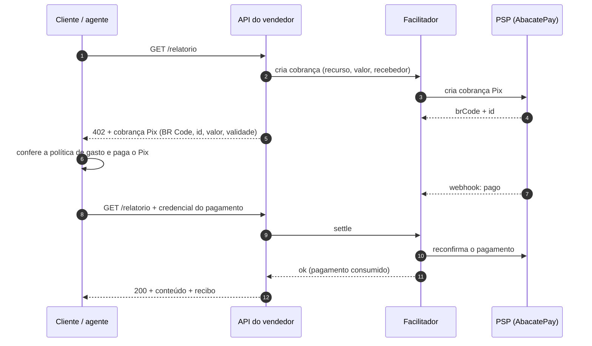

# p-x402 — HTTP 402 pago com Pix

> Uma API responde `402 Payment Required` com uma cobrança Pix. O cliente, que pode ser um agente de IA, paga e recebe o recurso. Não precisa de cadastro nem de chave de API.

**Status:** em desenvolvimento para o **Hack Brasil 2026**, trilha *Pagamentos & finanças*. Tudo roda em sandbox, com dados fictícios.

---

## O problema

O status HTTP `402 Payment Required` existe desde a primeira versão do HTTP e até hoje não tem significado padronizado: a RFC 9110 diz apenas que ele é *"reserved for future use"*.

Enquanto isso, cobrar por uso já é normal no Brasil. Consultas de CNPJ, CEP, certidões e dados fiscais custam centavos por chamada. Só que toda API paga exige o mesmo ritual antes da primeira chamada: **abrir conta, aceitar contrato, gerar chave de API e recarregar saldo num painel.**

Um humano faz isso uma vez. Um **agente de IA** que precisa de cinco fontes pagas numa tarde não consegue fazer sozinho. E as poucas APIs brasileiras que já aceitam agentes via [x402](https://www.x402.org/) cobram em **USDC (cripto)**, não em reais.

## A solução

O **p-x402** dá ao 402 um significado brasileiro: **a resposta 402 carrega uma cobrança Pix.**



1. O cliente pede um recurso pago.
2. O servidor responde **402** com uma cobrança Pix nova: o BR Code "copia e cola", o identificador da cobrança, o valor e a validade.
3. O cliente paga.
4. O PSP do vendedor confirma o pagamento por webhook.
5. O cliente repete a requisição com uma credencial que referencia o pagamento e recebe o recurso junto com um recibo.

Para quem consome, é um `fetch` que entende 402. Para quem vende, é um middleware e um preço por rota.

## Como isso se encaixa no x402

O [x402](https://www.x402.org/) é o protocolo aberto de pagamentos sobre HTTP 402, hoje mantido pela x402 Foundation na Linux Foundation. Ele já prevê redes que não são blockchain e um fluxo chamado `upfront`, em que se liquida antes de servir. O p-x402 **não cria um protocolo novo**: ele define como o Pix cabe dentro do x402 v2.

| Campo x402 v2 | No p-x402 |
| --- | --- |
| `scheme` | `exact` |
| `network` | `pix:br` |
| `asset` | `BRL` |
| `amount` | centavos, como string (ex.: `"500"`) |
| `extra.paymentFlow` | `upfront`: o Pix é *push* e não tem "autorizar agora, capturar depois" |
| `extra` | `brCode` e `chargeId` da cobrança gerada para aquele 402 |

**A diferença central em relação ao x402 com cripto:** lá, o pedido de pagamento é estático (endereço, valor, token). No Pix, **cada 402 precisa de uma cobrança nova**, com BR Code e id próprios. Por isso o facilitador ganha uma extensão para criar e consultar cobranças (`POST /pix/charges` e `GET /pix/charges/:id`), além dos endpoints padrão `verify`, `settle` e `supported`.

## Princípios de desenho

- **O dinheiro nunca passa por nós.** O Pix cai direto na conta do vendedor no PSP dele. O p-x402 só cria a cobrança, verifica e entrega o acesso.
- **Só o facilitador conhece o PSP.** O servidor que vende o recurso só precisa saber a URL do facilitador. A chave do AbacatePay fica num lugar só.
- **PSP trocável.** O AbacatePay fica isolado atrás de uma interface (`PixProvider`). Existe um PSP em memória (mock) para desenvolver e testar sem chave nenhuma.
- **O webhook sozinho não basta.** Antes de liberar o recurso, o facilitador reconfirma o pagamento direto no PSP.
- **Nenhum dado pessoal por padrão.** O servidor não recebe o CPF do pagador.
- **Uma spec, qualquer linguagem.** O facilitador é implementado uma vez só. Os SDKs são finos: tipos, headers e cliente do facilitador saem de uma especificação aberta (JSON Schema + OpenAPI), e test-vectors de conformidade garantem que todos falam o mesmo protocolo.

### Regras do `/settle`

O facilitador só aprova um pagamento se **todas** as condições abaixo forem verdadeiras:

1. A cobrança existe e foi criada pelo próprio facilitador.
2. O recurso, o valor e o recebedor batem com o que foi gravado quando a cobrança foi criada. Isso impede usar o pagamento de um recurso barato para liberar um caro.
3. O PSP confirma que a cobrança está paga.
4. O pagamento ainda não foi usado. A marcação de "consumido" é atômica, então o mesmo Pix não libera duas requisições.
5. A cobrança não está em disputa (MED) nem foi reembolsada.

## Por que, no futuro, crédito pré-pago

Receber um Pix custa uma **tarifa fixa** nos PSPs com foco em desenvolvedor: R$ 0,80 por transação no AbacatePay, com cobrança mínima de R$ 1,00. Já um dado brasileiro típico custa poucos centavos por consulta.

| Preço da chamada | Tarifa com 1 Pix por chamada (AbacatePay) |
| --- | --- |
| R$ 0,05 | impossível (mínimo de R$ 1,00) |
| R$ 1,00 | 80% |
| R$ 10,00 | 8% |
| **Depósito de R$ 20 em crédito** (400 chamadas de R$ 0,05) | **4%** |

Por isso o projeto tem duas etapas:

- **Agora (MVP):** um Pix por chamada, ideal para recursos de valor mais alto (relatórios, documentos, consultas completas).
- **Próxima etapa:** **crédito pré-pago**. Um Pix maior abre um saldo que paga muitas chamadas. O Pix continua caindo direto na conta do vendedor, e o crédito só vale naquele vendedor: assim ninguém guarda saldo de terceiros. A arquitetura já separa o core do PSP para isso entrar como um pacote novo sem mexer no resto.

## Arquitetura e SDK

Os detalhes técnicos ficam no [README principal](../README.md): o passo a passo de uma compra com os headers decodificados, os pacotes TypeScript, os SDKs em várias linguagens, o layout do repositório e o roadmap. Em resumo:

| Peça | Papel |
| --- | --- |
| **Facilitador** | Serviço HTTP implementado uma vez só, em TypeScript. Cria as cobranças, recebe os webhooks e aplica as regras do `/settle`. É o único que tem a chave do PSP. |
| **SDK de quem vende** (`@p-x402/server`) | Protege rotas com 402 e Pix. Não conhece o PSP e não tem banco de dados. Adapters para Hono, Express, Elysia e Fastify. |
| **SDK de quem compra** (`@p-x402/client`) | Um `fetch` que recebe o 402, aplica a política de gasto, paga e repete a chamada. |
| **PSP** (`@p-x402/abacatepay`) | Implementa a interface `PixProvider`. O primeiro é o AbacatePay; outros entram pela mesma interface. |

Stack: Bun, Hono, Zod v4 e Biome.

## Exemplo de uso

> Planejado. Os nomes seguem o [README principal](../README.md#uso-planejado).

**Quem vende (Hono):**

```ts
import { pixPaywall } from "@p-x402/server/hono"

const pix = pixPaywall({ facilitatorUrl: "https://facilitator.exemplo.com", token: process.env.PX402_MERCHANT_TOKEN })

app.get("/relatorio", pix({ amount: "500", description: "Relatório PDF" }), (c) => c.json(gerar())) // R$ 5,00
```

**Quem compra (pessoa ou agente):**

```ts
import { wrapFetch } from "@p-x402/client"
import { terminalPayer } from "@p-x402/client/terminal"

const fetchPago = wrapFetch(fetch, {
  payer: terminalPayer(),                          // ou simulatePayer() em dev
  policy: { maxPerRequest: 1000, maxTotal: 5000 }, // teto de R$ 10,00 por chamada
})

const res = await fetchPago("https://api.exemplo.com.br/relatorio")
```

**Como executar:** os comandos vão ficar no [README principal](../README.md) quando o código entrar no repositório. Tudo vai rodar sem chave nenhuma, com um PSP mock, ou com o AbacatePay em Modo Teste, que simula o pagamento sem dinheiro real.

## Escopo do hackathon

**Dentro:**
- Fluxo completo 402 → Pix → 200 com recibo, no padrão x402 v2.
- Facilitador com AbacatePay em Modo Teste e com PSP mock.
- Regras de segurança do `/settle`: anti-replay, valor e recurso amarrados ao pagamento, reconfirmação no PSP, disputa.
- Demo de ponta a ponta e testes automatizados.
- Especificação do protocolo e SDK de referência em TypeScript.

**Fora, por enquanto:**
- SDKs em outras linguagens, gerados da mesma spec. Ordem prevista: Python (ecossistema de agentes de IA), Java (bancos e fintechs), PHP (e-commerce brasileiro), depois Go e C#.
- Facilitador hospedado como serviço. No MVP, o vendedor roda o próprio facilitador.
- Pagamento automático real a partir da conta do agente. Hoje nenhum PSP permite testar isso em sandbox, então na demo o pagamento é **simulado**, e isso fica dito explicitamente.
- Crédito pré-pago, Pix Automático e devolução parcial.
- Múltiplos PSPs em produção e emissão de nota fiscal.

## Contexto

- **Comércio por agentes ainda é pequeno no mundo**, e o pouco que roda com dinheiro real usa quase só stablecoin. No Brasil, o espaço "agente paga API em reais" está aberto, mas a demanda ainda não foi provada.
- **Nenhum PSP brasileiro responde 402.** Os MCPs de PSP que existem servem o lojista (criar e listar cobranças), não o agente que compra.
- **Diferencial do p-x402:** um mapeamento aberto do Pix dentro do x402, que qualquer PSP pode implementar, sem custódia e com regras explícitas de verificação.

## Time

| Nome | Papel |
| --- | --- |
| _a preencher_ | |
| _a preencher_ | |
| _a preencher_ | |

## Licença

_A definir._
