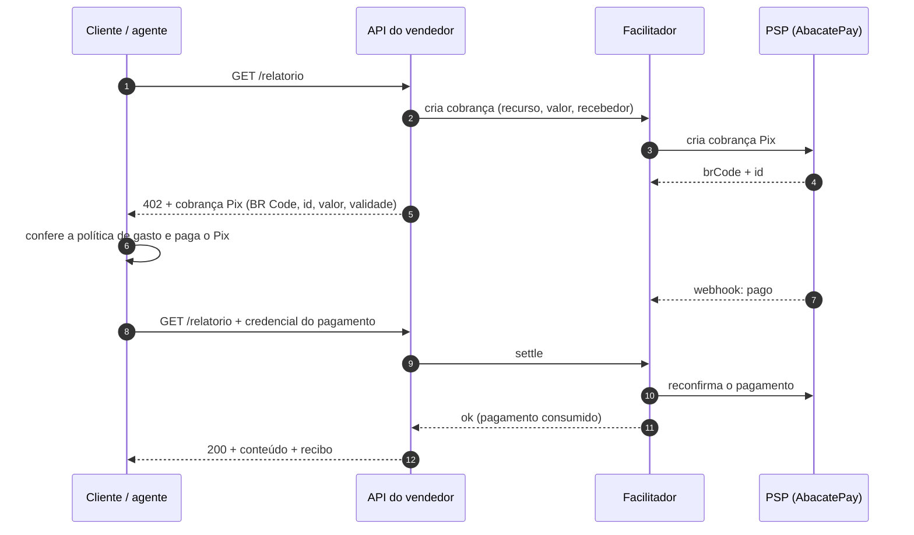

# p-x402 — HTTP 402 pago com Pix

> Uma API responde `402 Payment Required` com uma cobrança Pix. O cliente, que pode ser um agente de IA, paga e recebe o recurso. Não precisa de cadastro nem de chave de API.

**Status:** em desenvolvimento para o **Hack Brasil 2026**, trilha *Pagamentos & finanças*. Tudo roda em sandbox, com dados fictícios.

---

## O problema

O status HTTP `402 Payment Required` existe desde a primeira versão do HTTP e até hoje não tem significado padronizado: a RFC 9110 diz apenas que ele é *"reserved for future use"*.

Enquanto isso, cobrar por uso já é normal no Brasil. Consultas de CNPJ, CEP, certidões e dados fiscais custam centavos por chamada. Só que toda API paga exige o mesmo ritual antes da primeira chamada: **abrir conta, aceitar contrato, gerar chave de API e recarregar saldo num painel.**

Um humano faz isso uma vez. Um **agente de IA** que precisa de cinco fontes pagas numa tarde não consegue fazer sozinho. E as poucas APIs brasileiras que já aceitam agentes via [x402](https://www.x402.org/) cobram em **USDC (cripto)**, não em reais.

## A solução

O **p-x402** dá ao 402 um significado brasileiro: **a resposta 402 carrega uma cobrança Pix.**



1. O cliente pede um recurso pago.
2. O servidor responde **402** com uma cobrança Pix nova: o BR Code "copia e cola", o identificador da cobrança, o valor e a validade.
3. O cliente paga.
4. O PSP do vendedor confirma o pagamento por webhook.
5. O cliente repete a requisição com uma credencial que referencia o pagamento e recebe o recurso junto com um recibo.

Para quem consome, é um `fetch` que entende 402. Para quem vende, é um plugin e um preço por rota.

## Como isso se encaixa no x402

O [x402](https://www.x402.org/) é o protocolo aberto de pagamentos sobre HTTP 402, hoje mantido pela x402 Foundation na Linux Foundation. Ele já prevê redes que não são blockchain e um fluxo chamado `upfront`, em que se liquida antes de servir. O p-x402 **não cria um protocolo novo**: ele define como o Pix cabe dentro do x402 v2.

| Campo x402 v2 | No p-x402 |
| --- | --- |
| `scheme` | `exact` |
| `network` | `pix:br` |
| `asset` | `BRL` |
| `amount` | centavos, como string (ex.: `"500"`) |
| `extra.paymentFlow` | `upfront`: o Pix é *push* e não tem "autorizar agora, capturar depois" |
| `extra` | `brCode` e `chargeId` da cobrança gerada para aquele 402 |

**A diferença central em relação ao x402 com cripto:** lá, o pedido de pagamento é estático (endereço, valor, token). No Pix, **cada 402 precisa de uma cobrança nova**, com BR Code e id próprios. Por isso o facilitador ganha uma extensão para criar e consultar cobranças (`POST /pix/charges` e `GET /pix/charges/:id`), além dos endpoints padrão `verify`, `settle` e `supported`.

## Princípios de desenho

- **O dinheiro nunca passa por nós.** O Pix cai direto na conta do vendedor no PSP dele. O p-x402 só cria a cobrança, verifica e entrega o acesso.
- **Só o facilitador conhece o PSP.** O servidor que vende o recurso só precisa saber a URL do facilitador. A chave do AbacatePay fica num lugar só.
- **PSP trocável.** O AbacatePay fica isolado atrás de uma interface (`PixProvider`). Existe um PSP em memória (mock) para desenvolver e testar sem chave nenhuma.
- **O webhook sozinho não basta.** Antes de liberar o recurso, o facilitador reconfirma o pagamento direto no PSP.
- **Nenhum dado pessoal por padrão.** O servidor não recebe o CPF do pagador.

### Regras do `/settle`

O facilitador só aprova um pagamento se **todas** as condições abaixo forem verdadeiras:

1. A cobrança existe e foi criada pelo próprio facilitador.
2. O recurso, o valor e o recebedor batem com o que foi gravado quando a cobrança foi criada. Isso impede usar o pagamento de um recurso barato para liberar um caro.
3. O PSP confirma que a cobrança está paga.
4. O pagamento ainda não foi usado. A marcação de "consumido" é atômica, então o mesmo Pix não libera duas requisições.
5. A cobrança não está em disputa (MED) nem foi reembolsada.

## Por que, no futuro, crédito pré-pago

Receber um Pix custa uma **tarifa fixa** nos PSPs com foco em desenvolvedor: R$ 0,80 por transação no AbacatePay, com cobrança mínima de R$ 1,00. Já um dado brasileiro típico custa poucos centavos por consulta.

| Preço da chamada | Tarifa com 1 Pix por chamada (AbacatePay) |
| --- | --- |
| R$ 0,05 | impossível (mínimo de R$ 1,00) |
| R$ 1,00 | 80% |
| R$ 10,00 | 8% |
| **Depósito de R$ 20 em crédito** (400 chamadas de R$ 0,05) | **4%** |

Por isso o projeto tem duas etapas:

- **Agora (MVP):** um Pix por chamada, ideal para recursos de valor mais alto (relatórios, documentos, consultas completas).
- **Próxima etapa:** **crédito pré-pago**. Um Pix maior abre um saldo que paga muitas chamadas. A arquitetura já separa o core do PSP para isso entrar como um pacote novo sem mexer no resto.

## Arquitetura

Monorepo com **Bun workspaces**, em TypeScript.

```
p-x402/
├── packages/
│   ├── core/      # @p-x402/core   — protocolo puro: tipos x402 v2, headers, schemas, erros
│   ├── psp/       # @p-x402/psp    — interface PixProvider + AbacatePay + mock em memória
│   ├── elysia/    # @p-x402/elysia — plugin para o servidor que vende recursos
│   └── client/    # @p-x402/client — fetch que trata 402 e paga
├── apps/
│   ├── facilitator/  # cria cobranças, recebe webhooks, faz verify/settle (Elysia + SQLite)
│   ├── demo-server/  # API "paga" de exemplo
│   └── demo-client/  # script que consome a API paga de ponta a ponta
└── docs/
```

| Peça | Papel |
| --- | --- |
| **core** | Tipos `PaymentRequired`, `PaymentPayload` e `SettlementResponse`, mais o encode/decode dos headers `PAYMENT-REQUIRED`, `PAYMENT-SIGNATURE` e `PAYMENT-RESPONSE`. Não depende de framework nem de PSP. |
| **psp** | `createCharge`, `getCharge` e, em desenvolvimento, `simulatePayment`. |
| **facilitator** | O único com a chave do PSP. Guarda as cobranças, valida o webhook e aplica as regras do `/settle`. |
| **elysia** | Uma linha por rota para cobrar. |
| **client** | Intercepta o 402, paga (QR no terminal ou pagamento simulado) e repete a chamada. |

## Como executar

> ⚠️ **Previsto.** Os comandos abaixo descrevem o fluxo planejado e vão ser atualizados conforme o código entrar no repositório.

**Pré-requisito:** [Bun](https://bun.sh/) 1.x.

```bash
git clone https://github.com/IagoDantas/p-x402.git
cd p-x402
bun install
cp .env.example .env     # sem chave nenhuma, tudo roda com o PSP mock
bun run demo             # sobe facilitador + demo-server e executa o demo-client
bun test                 # testes unitários e ponta a ponta com o mock
```

Para usar o **AbacatePay em Modo Teste**, preencha `ABACATEPAY_API_KEY` (chave `abc_dev_…`) e `WEBHOOK_SECRET` no `.env`. No Modo Teste, o pagamento é feito pela própria API de simulação do AbacatePay, sem dinheiro real.

## Exemplo de uso

**Quem vende:**

```ts
new Elysia()
  .use(x402Pix({ facilitatorUrl, payTo: "merchant_123" }))
  .get("/relatorio", () => gerarPdf(), {
    x402: { amount: 500, description: "Relatório" }, // R$ 5,00
  });
```

**Quem compra (pessoa ou agente):**

```ts
const pagoFetch = wrapPixFetch(fetch, { payer: terminalPayer() }); // ou simulatePayer() em dev
const res = await pagoFetch("http://localhost:3000/relatorio");
```

## Escopo do hackathon

**Dentro:**
- Fluxo completo 402 → Pix → 200 com recibo, no padrão x402 v2.
- Facilitador com AbacatePay em Modo Teste e com PSP mock.
- Regras de segurança do `/settle`: anti-replay, valor e recurso amarrados ao pagamento, reconfirmação no PSP, disputa.
- Demo de ponta a ponta e testes automatizados.

**Fora, por enquanto:**
- Pagamento automático real a partir da conta do agente. Hoje nenhum PSP permite testar isso em sandbox, então na demo o pagamento é **simulado**, e isso fica dito explicitamente.
- Crédito pré-pago, Pix Automático e devolução parcial.
- Múltiplos PSPs em produção e emissão de nota fiscal.

## Contexto

- **Comércio por agentes ainda é pequeno no mundo**, e o pouco que roda com dinheiro real usa quase só stablecoin. No Brasil, o espaço "agente paga API em reais" está aberto, mas a demanda ainda não foi provada.
- **Nenhum PSP brasileiro responde 402.** Os MCPs de PSP que existem servem o lojista (criar e listar cobranças), não o agente que compra.
- **Diferencial do p-x402:** um mapeamento aberto do Pix dentro do x402, que qualquer PSP pode implementar, sem custódia e com regras explícitas de verificação.

## Time

| Nome | Papel |
| --- | --- |
| _a preencher_ | |
| _a preencher_ | |
| _a preencher_ | |

## Licença

_A definir._
