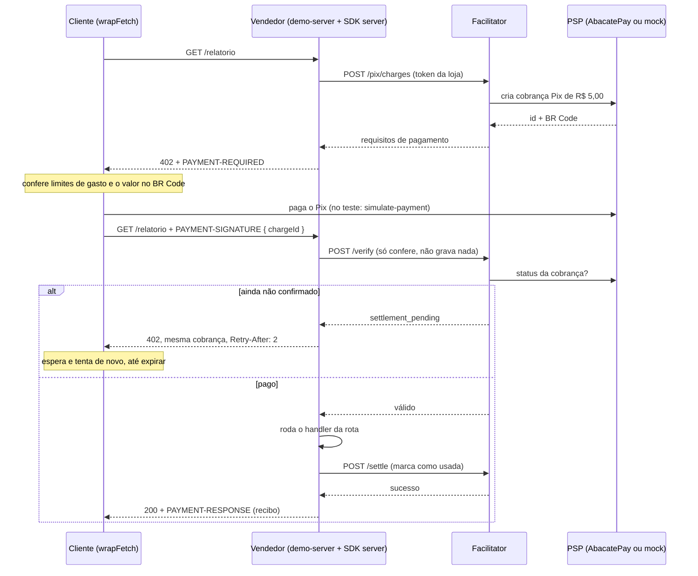

# Guia do MVP do p-x402

Este guia explica o que a primeira versão faz, como as peças conversam, como os testes funcionam, como testar na mão e o que fazer daqui até a entrega do Hack Brasil (30/11, 23:59 de Brasília).

O código está no PR [IagoDantas/p-x402#1](https://github.com/IagoDantas/p-x402/pull/1), branch `mvp-round-trip`.

---

## 1. Em uma frase

Uma API responde `402 Payment Required` com uma cobrança Pix. O cliente paga, repete a requisição com o id da cobrança e recebe `200` com o conteúdo e um recibo. Para quem usa o SDK cliente, tudo isso acontece dentro de um único `fetch`.

---

## 2. As peças

| Peça | Pasta | O que faz |
|---|---|---|
| **core** | `packages/core` | Formato das mensagens do x402 v2 (schemas Zod), codificação dos headers em base64, erros com código fixo (`Px402Error`), leitura do BR Code (o "copia e cola" do Pix) |
| **psp** | `packages/psp` | A interface `PixProvider`, que esconde qual PSP está por trás, o adapter do AbacatePay e um PSP falso em memória (o "mock") para testes e demo |
| **facilitator** | `apps/facilitator` | O único serviço que tem a chave do AbacatePay. Cria cobranças, confere pagamentos, impede que um pagamento seja usado duas vezes e recebe webhooks |
| **server** | `packages/server` | SDK de quem vende. Um middleware Hono que protege uma rota: responde 402, fala com o facilitator e libera a rota quando o pagamento é válido |
| **client** | `packages/client` | SDK de quem compra. `wrapFetch` troca o `fetch` por um que paga sozinho, respeitando limites de gasto |
| **demo-server** | `apps/demo-server` | API de exemplo com uma rota paga: `GET /relatorio` por R$ 5,00 |
| **demo-client** | `apps/demo-client` | Comprador de exemplo e a demo tudo-em-um (`bun run demo:local`) |

Regra de projeto: as bibliotecas (`packages/*`) usam só padrões web (`fetch`, `Request`, `Response`, WebCrypto), para rodar em Node, Deno, Workers ou Bun. Só os apps usam APIs do Bun (o `bun:sqlite`, por exemplo). O `bun run typecheck` garante isso: ele também checa as bibliotecas sem os tipos do Bun.

---

## 3. Como uma compra acontece



Por que essa ordem (verificar, rodar o handler, liquidar):

- **`/verify` não grava nada.** Ele confere tudo, inclusive o status no PSP, mas não marca a cobrança.
- **O handler roda antes de a cobrança ser consumida.** Se o handler falhar (erro 500, por exemplo), a cobrança continua paga e não usada, e o cliente pode repetir com o mesmo `chargeId` sem pagar de novo.
- **`/settle` só roda depois de uma resposta sem erro** e marca a cobrança como usada de forma atômica (`UPDATE ... WHERE consumed_at IS NULL`). Se duas requisições chegarem com a mesma cobrança, só uma ganha.

### Regras de segurança que o facilitator aplica

Antes de aprovar, o facilitator confere tudo isto:

1. A cobrança existe e foi criada por ele.
2. Ela pertence à loja dona do token.
3. Valor, recebedor (`payTo`) e URL do recurso batem com o que foi gravado quando a cobrança foi criada. Pagar R$ 1 e usar numa rota de R$ 50 não funciona.
4. **O PSP confirma `PAID` na hora.** O webhook nunca basta sozinho. Se o PSP der erro, a resposta é "pendente", nunca "pago".
5. A cobrança não está em disputa (MED) nem foi estornada.
6. Ela ainda não foi usada.
7. Uma cobrança paga vale por até 24 h depois do pagamento, mesmo que já tenha expirado.

Proteções extras, que vieram da revisão adversária:

- **Limites de criação de cobranças:** 10 por minuto por IP (no SDK do vendedor) e 60 por minuto por loja (no facilitator). Acima disso a resposta é `429` com `Retry-After`, e nenhuma cobrança é criada.
- **Resposta do `/settle` perdida:** o vendedor repete o `/settle` com a mesma `Idempotency-Key`, e o facilitator devolve o mesmo sucesso. Assim uma resposta perdida no meio do caminho não queima um pagamento.
- **Mesma cobrança em várias requisições simultâneas:** uma trava por cobrança faz o handler rodar uma vez só. As outras recebem `402 settlement_pending`.
- **Proteções do cliente:**
  - não paga se a resposta veio de um redirecionamento, e nunca segue um redirecionamento depois de pagar (o `PAYMENT-SIGNATURE` não vai para outro domínio);
  - não espera um `settlement_pending` por mais de 10 minutos (`retry.maxWaitMs`), mesmo que o vendedor mande um `expiresAt` ou `Retry-After` maior;
  - não paga se a URL do recurso é de outro domínio;
  - não paga se o valor dentro do BR Code é diferente do anunciado;
  - não paga um BR Code ambíguo, que cada banco poderia ler de um jeito: com tag repetida, caractere fora do ASCII, template de conta que não se lê direito, ou sem exatamente um template Pix;
  - não paga um BR Code dinâmico (com URL de location), porque o valor de verdade está atrás da URL, a não ser que o pagador declare `checksDynamicAmount: true` e confira esse valor ele mesmo.
- **Dados do pagador** (nome, CPF) que chegam no webhook nunca são gravados nem repassados (LGPD).

### Os três headers

| Header | Quem manda | Conteúdo (JSON em base64) |
|---|---|---|
| `PAYMENT-REQUIRED` | vendedor, no 402 | o que pagar: valor, recebedor, `chargeId`, BR Code, expiração |
| `PAYMENT-SIGNATURE` | cliente, na repetição | os requisitos aceitos + `{ "chargeId": "..." }` |
| `PAYMENT-RESPONSE` | vendedor | recibo: `{ success, transaction, network, amount }` ou o motivo da falha (`errorReason`) |

Os motivos de falha mais comuns são estes:

| Motivo | Significa |
|---|---|
| `settlement_pending` | Pagamento ainda não confirmado pelo PSP. Tente de novo depois do `Retry-After`. |
| `charge_already_consumed` | Essa cobrança já foi usada. |
| `charge_expired` | A cobrança expirou sem pagamento. |
| `amount_mismatch`, `pay_to_mismatch`, `resource_mismatch` | A cobrança é de outro valor, recebedor ou rota. |
| `charge_disputed`, `charge_refunded` | O pagamento está em disputa ou foi estornado. |
| `policy_exceeded` | O cliente recusou pagar: passou do limite ou o domínio não é permitido. Esse erro nasce no cliente; nenhum pagamento acontece. |

---

## 4. Os testes

### Rodar

```bash
bun test
```

São 307 testes em 13 arquivos e rodam em menos de meio segundo. Para rodar um arquivo só, ou só os testes cujo nome contém um texto:

```bash
bun test apps/facilitator
```

```bash
bun test -t "settlement_pending"
```

Antes de abrir PR, rode também:

```bash
bun run typecheck
```

```bash
bun run lint
```

`bun run format` corrige a formatação sozinho.

### Por que são rápidos e não falham aleatoriamente

- **Relógio falso:** toda peça que depende de tempo recebe uma função `now()`. Nos testes, o tempo só anda quando o teste manda, então "esperar a cobrança expirar" é instantâneo.
- **PSP falso:** `createMockPixProvider` imita o AbacatePay em memória. Ele cria cobranças com ids previsíveis (`pix_char_mock_0001`), simula pagamento, disputa e estorno, pode fingir que o PSP caiu e gera webhooks no mesmo formato do AbacatePay.
- **Tudo no mesmo processo:** os testes ligam cliente → vendedor → facilitator chamando `app.fetch` direto, sem abrir portas.
- **AbacatePay sem rede:** o adapter é testado com um `fetch` falso que devolve respostas no formato da API real.

### O que cada arquivo cobre

| Arquivo | Testes | Cobre |
|---|---:|---|
| `packages/core/test/codec.test.ts` | 8 | Ida e volta dos três headers, acentos, headers inválidos ou grandes demais |
| `packages/core/test/brcode-matching.test.ts` | 6 | Leitura do BR Code (valor, CRC) e comparação entre requisitos aceitos e exigidos |
| `packages/core/test/util.test.ts` | 2 | Limitador de taxa e comparação de segredos em tempo constante |
| `packages/psp/test/mock.test.ts` | 7 | Ciclo de vida do PSP falso, webhooks e BR Code válido |
| `packages/psp/test/abacatepay.test.ts` | 31 | Chamadas HTTP do adapter, mapeamento de status, erros, timeout, chave nunca vazada, webhook com segredo certo, errado ou vazio |
| `apps/facilitator/test/store.test.ts` | 20 | Os dois armazenamentos (memória e SQLite): consumo atômico, deduplicação de webhooks, limpeza |
| `apps/facilitator/test/app.test.ts` | 128 | Todas as rotas e regras: auth, limite por loja, pagamento reutilizado, valor/recebedor/recurso trocados, expirada, paga dentro de 24 h, disputa, estorno, corrida entre duas liquidações, webhook duplicado ou com segredo errado, PSP fora do ar |
| `packages/server/test/paywall.test.ts` | 47 | O middleware sem framework: limite por IP, ordem verify → handler → settle, `settlement_pending` com a mesma cobrança, handler com erro não liquida, repetição do `/settle`, trava por cobrança, facilitator fora do ar |
| `packages/server/test/hono.test.ts` | 13 | O adapter Hono: IP do cliente, handler que lança exceção, `HEAD` |
| `packages/server/test/ip.test.ts` | 3 | Como o IP vira chave do limitador (IPv6 por /64) |
| `packages/client/test/wrap-fetch.test.ts` | 26 | O `fetch` que paga: limites de gasto, BR Code, redirecionamento, backoff, timeout, retomar pagamento, chamadas simultâneas sem gastar demais |
| `packages/client/test/payers.test.ts` | 4 | O `simulatePayer` |
| `apps/demo-client/test/round-trip.test.ts` | 12 | **Ponta a ponta** com as peças reais e o PSP falso: compra feliz, pagamento atrasado, handler com erro e retomada, pagamento reutilizado, três requisições simultâneas, expiração, limite do cliente, resposta do `/settle` perdida, TTL diferente de 300 s |

Para entender o sistema lendo testes, comece pelo `round-trip.test.ts`. Ele conta a história inteira em poucos casos.

---

## 5. Testar na mão

### 5.1 A demo pronta (30 segundos)

```bash
bun install
```

```bash
bun run demo:local
```

Sobe tudo num processo só, com o PSP falso, e imprime cada passo: o `402` com a cobrança, o pagamento, um `402 settlement_pending` (o PSP falso confirma 1,5 s depois) e o `200` com o recibo. Nenhum dinheiro real.

### 5.2 Três processos com o PSP falso, usando curl

Abra três terminais na pasta do projeto. Os dois primeiros sobem os serviços:

```bash
PX402_PROVIDER=mock PX402_MERCHANT_TOKEN=tok-local PX402_DEV_SIMULATE=1 PX402_DB_PATH= bun run dev:facilitator
```

```bash
PX402_MERCHANT_TOKEN=tok-local PX402_FACILITATOR_URL=http://localhost:4020 bun run dev:server
```

No terceiro, siga os passos abaixo. As variáveis passadas na linha de comando valem mais que o `.env`, então estes comandos funcionam mesmo que seu `.env` aponte para o AbacatePay.

**1. O que o facilitator aceita:**

```bash
curl -s localhost:4020/supported
```

**2. Pedir o recurso sem pagar.** A resposta é `402` e o header `PAYMENT-REQUIRED` traz a cobrança:

```bash
REQ=$(curl -s -D - -o /dev/null localhost:4021/relatorio | grep -i '^payment-required:' | cut -d' ' -f2 | tr -d '\r') && echo "$REQ" | base64 -d
```

**3. Montar a prova de pagamento** (o header `PAYMENT-SIGNATURE`) e guardar o id da cobrança:

```bash
SIG=$(bun -e 'const r=JSON.parse(Buffer.from(process.argv[1],"base64").toString());const a=r.accepts[0];console.log(Buffer.from(JSON.stringify({x402Version:2,resource:r.resource,accepted:a,payload:{chargeId:a.extra.chargeId}})).toString("base64"))' "$REQ") && ID=$(echo "$REQ" | base64 -d | bun -e 'console.log(JSON.parse(await Bun.stdin.text()).accepts[0].extra.chargeId)') && echo $ID
```

**4. Repetir antes de pagar.** Volta `402` com `Retry-After: 2` e `settlement_pending`:

```bash
curl -si localhost:4021/relatorio -H "PAYMENT-SIGNATURE: $SIG" | grep -iE '^HTTP|retry-after|payment-response'
```

**5. "Pagar"** (rota só de desenvolvimento, ligada por `PX402_DEV_SIMULATE=1`):

```bash
curl -si -X POST localhost:4020/dev/charges/$ID/simulate-payment | head -1
```

**6. Repetir de novo.** Agora volta `200` com o relatório:

```bash
curl -si localhost:4021/relatorio -H "PAYMENT-SIGNATURE: $SIG"
```

**7. Tentar usar o mesmo pagamento outra vez.** O motivo da recusa é `charge_already_consumed`:

```bash
curl -s -D - -o /dev/null localhost:4021/relatorio -H "PAYMENT-SIGNATURE: $SIG" | grep -i payment-response | cut -d' ' -f2 | tr -d '\r' | base64 -d
```

**8. Estourar o limite de cobranças.** Depois de 10 cobranças no mesmo minuto vem `429`:

```bash
for i in $(seq 1 11); do curl -s -o /dev/null -w "%{http_code} " localhost:4021/relatorio; done; echo
```

Para ver o fluxo com o SDK cliente em vez de curl, rode `bun run demo` (com o `.env` configurado, veja abaixo).

### 5.3 Com o sandbox do AbacatePay

Crie um `.env` na raiz (ele está no `.gitignore` e nunca vai para o Git):

```
PX402_PROVIDER=abacatepay
ABACATEPAY_API_KEY=abc_dev_...sua chave de dev...
ABACATEPAY_WEBHOOK_SECRET=
PX402_DB_PATH=./p-x402.sqlite
PX402_MERCHANT_ID=loja1
PX402_MERCHANT_TOKEN=qualquer-texto-longo-e-aleatorio
PX402_PAY_TO=loja1
PX402_DEV_SIMULATE=1
PORT=4020
PX402_FACILITATOR_URL=http://localhost:4020
DEMO_SERVER_PORT=4021
DEMO_SERVER_URL=http://localhost:4021/relatorio
```

Depois, um comando em cada terminal:

```bash
bun run dev:facilitator
```

```bash
bun run dev:server
```

```bash
bun run demo
```

O resultado esperado:

- uma cobrança real do sandbox (`pix_char_...`);
- o pagamento via `simulate-payment`;
- um ou dois `402 settlement_pending`, porque o sandbox leva alguns segundos para marcar `PAID`;
- o `200` no fim.

As cobranças aparecem no painel do AbacatePay em modo dev. Esse caminho já foi rodado de ponta a ponta com a sua chave.

Dois detalhes do sandbox:

- O BR Code do modo dev não é um Pix válido: o CRC está errado. Nenhum banco aceitaria. O `simulatePayer` não paga o BR Code, então o cliente pula essa checagem só para ele. Um pagador real continua com a checagem completa.
- `PX402_DEV_SIMULATE=1` deixa qualquer pessoa marcar cobranças como pagas. Só use em desenvolvimento.

### 5.4 Webhook: precisa?

Para funcionar, não. O facilitator pergunta o status ao AbacatePay a cada tentativa, e essa resposta é a verdade. O webhook só acelera: avisa do pagamento, de disputas e de estornos antes da próxima tentativa.

Para ligar (este caminho já foi testado com o sandbox e um túnel do cloudflared):

1. **Crie um segredo** com pelo menos 32 caracteres. Quem escolhe o segredo é você; o AbacatePay só o repete em cada entrega:

   ```bash
   openssl rand -hex 32
   ```

2. **Suba o facilitator** com `ABACATEPAY_WEBHOOK_SECRET=<segredo>` no `.env`.
3. **Exponha o facilitator na internet.** Instale o cloudflared com `brew install cloudflared` e rode:

   ```bash
   cloudflared tunnel --url http://localhost:4020
   ```

   Ele imprime uma URL `https://<nome>.trycloudflare.com`.
4. **Cadastre o webhook**, pelo painel do AbacatePay (Integração → Webhooks → Criar, versão v2) ou pela API:

   ```bash
   curl -s -X POST https://api.abacatepay.com/v2/webhooks/create -H "authorization: Bearer $ABACATEPAY_API_KEY" -H "content-type: application/json" -d '{"name":"p-x402","endpoint":"https://<nome>.trycloudflare.com/webhooks/pix","secret":"<segredo>","events":["transparent.completed","transparent.disputed","transparent.refunded"]}'
   ```

5. **Teste:** pague uma cobrança com `simulate-payment`. Em um ou dois segundos o AbacatePay manda o `transparent.completed`, e o facilitator responde `{"ok":true,"applied":true}`.

O facilitator confere duas coisas em cada entrega:

- o segredo, comparado em tempo constante, que prova a origem;
- o `X-Webhook-Signature` (HMAC-SHA256 do corpo com a chave pública do AbacatePay), que prova que o corpo não foi alterado.

Sem segredo configurado, a rota `/webhooks/pix` fica desligada (responde 404) de propósito, para ninguém mandar eventos falsos.

Webhooks não podem ser editados no AbacatePay. Para mudar a URL (por exemplo, depois de reiniciar o túnel rápido, que troca de endereço), crie outro e apague o antigo com `POST /v2/webhooks/delete`.

---

## 6. O que fazer agora

Faltam cinco dias. A ordem abaixo prioriza ter uma demo sólida e o PR entregue; o resto é bônus.

### Hoje: fechar o MVP

1. **Rodar você mesmo.** Faça a seção 5.1 e depois a 5.3 com o seu `.env`. Assim você vê com os próprios olhos o que o código faz.
2. **Revisar o PR com o time.** O repositório é do Iago. Peça para ele e o Henrique lerem a descrição do [PR #1](https://github.com/IagoDantas/p-x402/pull/1) e este guia. O PR é grande (feito do zero); a forma mais rápida de revisar é rodar a demo e ler o `round-trip.test.ts`.
3. **Fazer o merge** quando o time estiver ok. Depois, todo mundo trabalha a partir do `main`.

### Amanhã: o que deixa a demo convincente

4. **Webhook:** já está testado com o sandbox (seção 5.4). Falta ver chegar um evento de estorno de verdade. Disputas não têm simulação no modo dev. Pela documentação, `APPROVED` é o status de cartão antes de virar `PAID`, então tratar como "não pago" está correto para Pix.
5. **Um pagador "humano"** para a demo: em vez do `simulatePayer`, um pagador que mostra o QR Code no terminal e espera a pessoa pagar no app do banco. A interface é pequena:

   ```ts
   { pay(cobranca) { /* mostra cobranca.brCode como QR */ } }
   ```

   O README já cita esse payer como plano. No sandbox o QR não é pagável, então isto só faz sentido com uma conta de produção (cada Pix custa R$ 5,00 + R$ 0,80 de tarifa). Decidam juntos se vale a pena mostrar um Pix de verdade no vídeo.
6. **Um agente de IA comprando.** Este é o argumento mais forte do projeto: um script curto em que um agente (com a API do Claude, por exemplo) usa o `wrapFetch` para comprar o relatório sozinho, respeitando o limite de gasto.

### Antes de entregar

7. **Publicar o facilitator e a API de exemplo** num lugar com URL pública. O facilitator usa `bun:sqlite` e `Bun.serve`, então não roda no Cloudflare Workers como está. Um serviço que rode Bun (Fly.io, Railway, Render ou uma VPS) resolve. A landing page continua no Cloudflare.
8. **Atualizar o roteiro do vídeo** (`docs/roteiro-video.md`) com o que existe de fato: `bun run demo:local` mostrando o `402 → Pix → 200`, a recusa por limite de gasto, a tentativa de reutilizar um pagamento sendo barrada e, se der tempo, o agente da etapa 6.
9. **Gravar o vídeo e enviar** antes de 30/11, 23:59.

### O que não fazer agora

SDKs em outras linguagens, adapters para outros frameworks, geração de OpenAPI, saldo pré-pago (scheme B), MCP e modo hospedado estão no roadmap, mas fora do escopo do hackathon.

### Limites conhecidos (para não ser pego de surpresa)

- A trava por cobrança e os limites de taxa ficam em memória, por processo. Com mais de uma instância do vendedor, é preciso roteamento fixo por cobrança.
- Uma resposta em streaming que falhe no meio já foi liquidada.
- O túnel rápido do cloudflared (`trycloudflare.com`) muda de URL a cada reinício. O webhook cadastrado para ele para de funcionar quando o túnel cai. Para uma URL fixa, use um túnel nomeado na conta Cloudflare do time ou publique o facilitator.
- Só foi testado no Bun. Node, Deno e Workers devem funcionar para as bibliotecas, mas ninguém rodou. Fora do Bun o middleware Hono não descobre o IP do comprador sozinho: passe `getClientIp`.
- Atrás de um proxy reverso (Cloudflare, nginx), o IP que o Bun vê é o do proxy, e todos os compradores dividem o mesmo limite de 10 por minuto. Passe `getClientIp` lendo um header que o seu proxy define (por exemplo `cf-connecting-ip`). Nunca leia um header que o cliente pode forjar.

---

## 7. Glossário rápido

- **402 Payment Required:** código HTTP para "pague antes". O x402 é o protocolo que padroniza como pedir e provar esse pagamento.
- **Facilitator:** o serviço que fala com o PSP e decide se um pagamento vale. O vendedor não precisa conhecer o PSP.
- **PSP:** quem emite a cobrança Pix e recebe o dinheiro (aqui, o AbacatePay).
- **BR Code:** o texto do "Pix copia e cola", que também vira o QR Code.
- **`chargeId`:** o id da cobrança no PSP (`pix_char_...`). É a prova de pagamento que o cliente manda.
- **verify / settle:** conferir sem gravar / marcar a cobrança como usada.
- **MED:** Mecanismo Especial de Devolução do Pix, usado em casos de fraude. Aqui ele aparece como "disputa".
